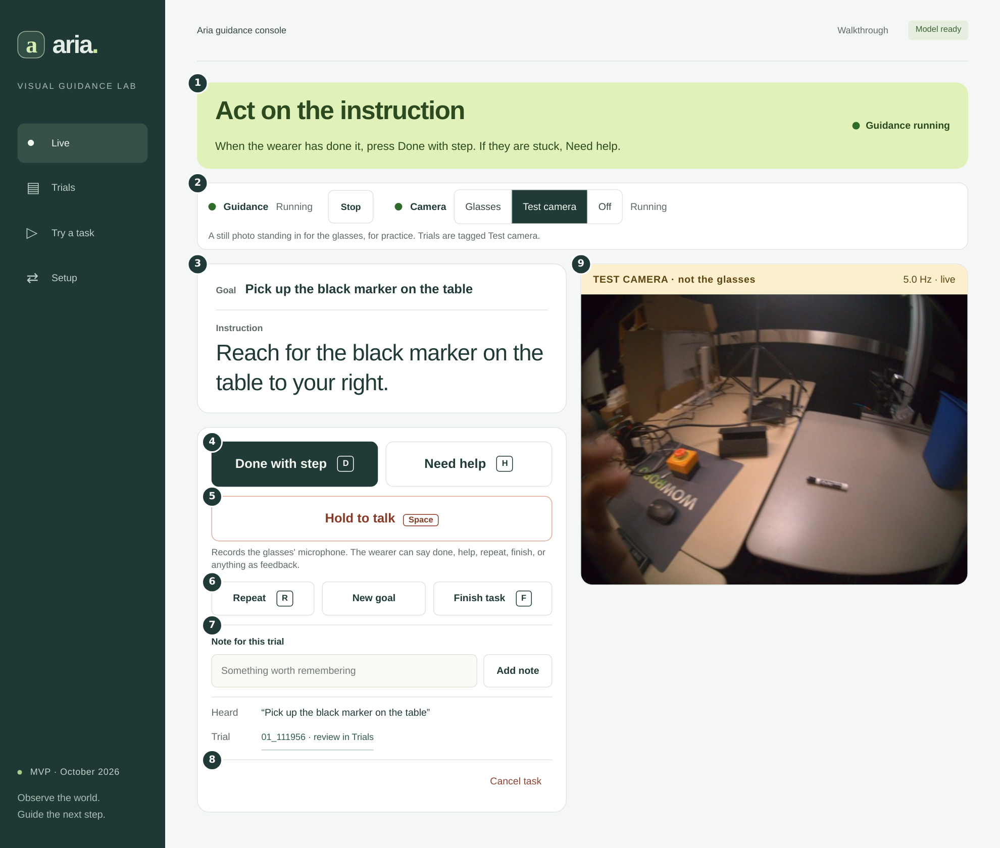
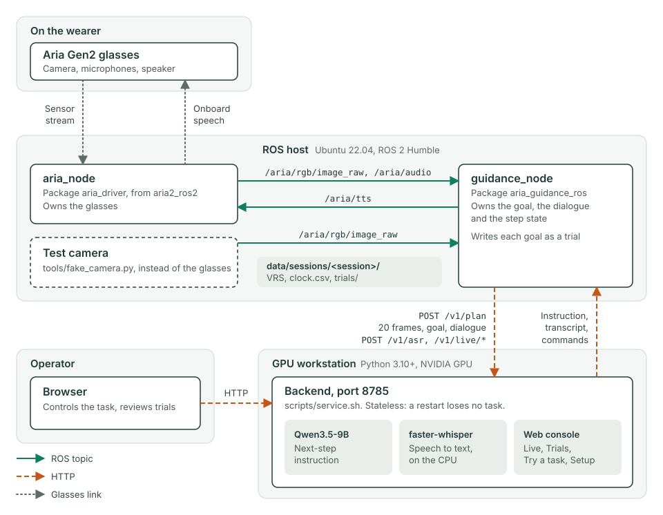
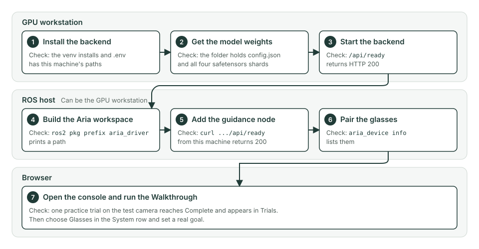
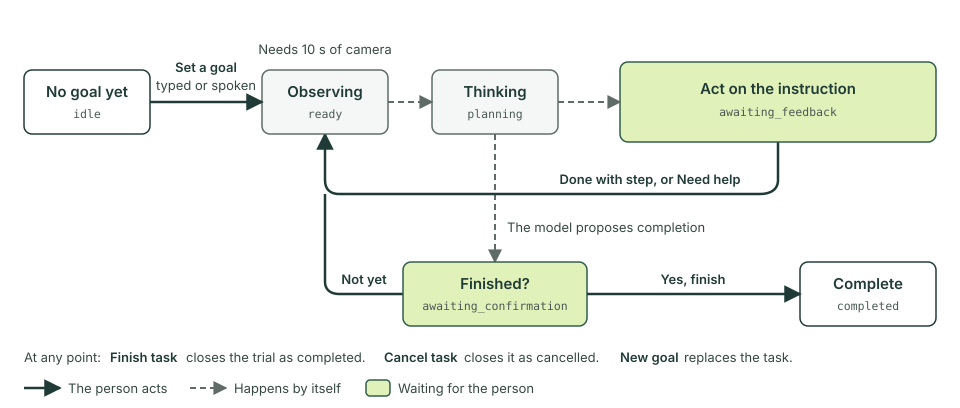
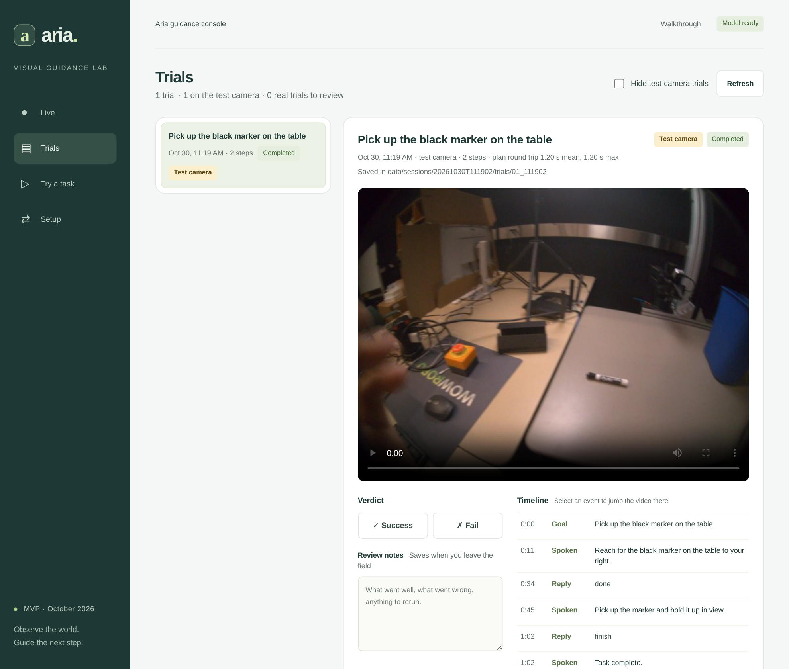
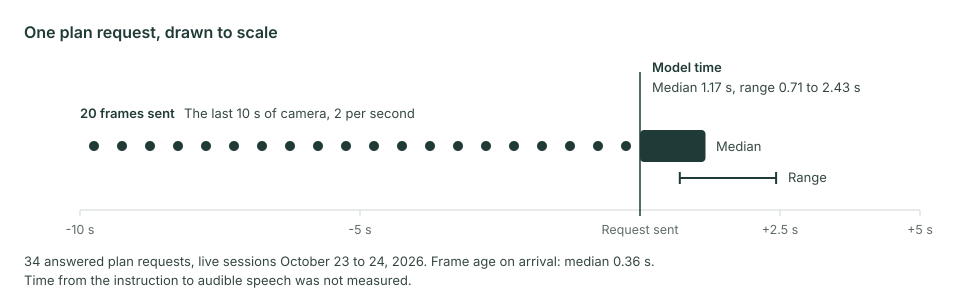

# Aria Visual Guidance

A person wears Project Aria Gen2 glasses and states a goal. A **Qwen3.5-9B** model looks at the last 10 seconds of their camera and speaks one next step through the glasses. An operator follows along in a web console, and every goal is saved as a trial to review later.



The Live view, shown with the test camera and a scripted model. [Run a task](#run-a-task) explains each number.

## How the parts fit



| Part | Comes from | What it does |
| --- | --- | --- |
| `aria_node` | [aria2_ros2](https://github.com/sparklabutah/aria2_ros2), package `aria_driver` | Connects to the glasses, publishes their streams, speaks text from `/aria/tts` |
| `guidance_node` | This repository, package `aria_guidance_ros` | Holds the goal, dialogue and step state, and writes trials |
| Backend | This repository, package `aria_guidance` | Runs the model and speech recognition, and serves the console |

`guidance_node` calls the backend's stateless `POST /v1/plan`, so a backend restart loses no task. It needs no change to `aria_node`. See [ROS control](docs/ros-control.md) for every topic and service.

The two ROS nodes and the backend can share one machine or use two. The console's System row starts processes on the backend's own machine, so with two machines you start the ROS nodes from a terminal ([step 5](#5-add-the-guidance-node)).

## Set up



| Machine | Needs |
| --- | --- |
| GPU workstation | Linux, Python 3.10 or newer, CUDA-enabled PyTorch, an NVIDIA GPU. A 32 GB GPU is recommended for BF16 weights and twenty images. |
| ROS host | Ubuntu 22.04, ROS 2 Humble and its Python 3.10, as the Aria SDK requires |

The backend and the Aria ROS workspace use separate Python environments, even on one machine.

### 1. Install the backend

```bash
git clone https://github.com/10-OASIS-01/aria_vlm.git
cd aria_vlm
python3 -m venv .venv
source .venv/bin/activate
python -m pip install --upgrade pip
# Install PyTorch/torchvision wheels appropriate for your NVIDIA driver first.
# Example for a CUDA 13.0-capable driver:
python -m pip install torch torchvision --index-url https://download.pytorch.org/whl/cu130
python -m pip install -e '.[model,speech]'
cp .env.example .env
```

Edit `.env` for your machine. [Settings](#settings) lists every key. Relative paths resolve from the project root when using `scripts/service.sh`, and GPU numbering inside PyTorch is relative to `CUDA_VISIBLE_DEVICES`.

```dotenv
ARIA_MODEL_PATH=./models/Qwen3.5-9B
ARIA_ASR_MODEL_PATH=./models/faster-whisper-small
CUDA_VISIBLE_DEVICES=0
ARIA_DEVICE=cuda:0
```

### 2. Get the model weights

Use the post-trained multimodal checkpoint `Qwen/Qwen3.5-9B`, not a text-only or Base checkpoint. No weights are included in this repository. An existing local checkpoint loads without contacting the model hub, so point `ARIA_MODEL_PATH` at a folder holding `config.json`, the tokenizer and processor files and all four safetensors shards. Otherwise download them once:

```bash
export HF_HOME=./models/hf-cache
python scripts/download_model.py --repo Qwen/Qwen3.5-9B --output ./models/Qwen3.5-9B
python scripts/download_model.py --repo Systran/faster-whisper-small --output ./models/faster-whisper-small
```

The downloader respects `HF_ENDPOINT`, so it can use your organization's permitted route or Hugging Face mirror. It does not start a VPN or install global proxy settings. Speech recognition uses faster-whisper small on the CPU in int8. Leave `ARIA_ASR_MODEL_PATH` empty if you only need typed goals.

### 3. Start the backend

```bash
bash scripts/service.sh start    # keeps running in tmux after you disconnect
bash scripts/service.sh status
bash scripts/service.sh stop     # stops only this project's tmux session
bash scripts/service.sh run      # or stay in the foreground, without tmux
```

The console opens at **http://127.0.0.1:8785/** while the weights load in the background. `/api/health` checks the process. `/api/ready` returns HTTP 200 once the model has loaded:

```bash
curl --noproxy '*' http://127.0.0.1:8785/api/ready
```

Keep to one server worker, because every worker would load its own model.

### 4. Build the Aria workspace

Clone aria2_ros2 beside this repository, where `ARIA_ROS_WORKSPACE=../aria2_ros2` expects it, and follow [its README](https://github.com/sparklabutah/aria2_ros2) to install ROS and `uv`:

```bash
cd ..
git clone https://github.com/MLee2324/aria2_ros2.git
cd aria2_ros2
./setup_env.sh
source activate.sh
ros2 pkg prefix aria_driver    # prints a path
```

The console runs `ros2 run aria_driver aria_node`, so the checkout must contain the `aria_driver` package. The `external/aria2_ros2` submodule is pinned to `1af73bd`, which does not, so do not build from it. If you already have a working checkout with that package, use it and skip `setup_env.sh`.

`activate.sh` sets `ROS_DOMAIN_ID=42`. Every Aria and guidance terminal must join the same domain.

### 5. Add the guidance node

From the `aria2_ros2` folder, install the lightweight guidance package into the Aria venv. This keeps the workspace's numpy, setuptools, pytest and SDK pins. The node imports no torch or transformers, so the model dependencies stay in the backend's environment.

```bash
export GUIDANCE_REPO="$PWD/../aria_vlm"
uv pip install --python "${ARIA_VENV:-$PWD/.venv}/bin/python" -e "$GUIDANCE_REPO"
ln -s "$GUIDANCE_REPO/ros2_ws/src/aria_guidance_ros" src/aria_guidance_ros
python -m colcon build --symlink-install --packages-select aria_guidance_ros
source activate.sh
```

On one machine, the System row starts both nodes, so go on to step 6. With two machines, reach the backend first, then start the nodes in two sourced terminals:

```bash
ssh -N -L 8785:127.0.0.1:8785 USER@GPU_HOST    # keeps the backend on loopback
curl --noproxy '*' http://127.0.0.1:8785/api/ready

ros2 launch aria_driver aria.launch.py
ros2 launch aria_guidance_ros guidance.launch.py backend_url:=http://127.0.0.1:8785
```

A custom file can be passed with `config:=...`, see [guidance.yaml](ros2_ws/src/aria_guidance_ros/config/guidance.yaml). Run `ros2 topic list -t` to confirm the camera, audio and TTS names, and change those three parameters if your lab's configuration differs.

<details>
<summary>Reach the backend through Nginx, or require a token</summary>

[deploy/nginx-location.conf](deploy/nginx-location.conf) maps `/aria/` to `127.0.0.1:8785/` and strips the prefix. Set `ARIA_ROOT_PATH=/aria` in the backend environment. The frontend uses relative asset and API URLs, including images and downloads. Register the route in both the active proxy configuration and any configuration generator you maintain, then validate and reload Nginx.

Pass the complete base URL to the node, for example `backend_url:=http://GPU_HOST:443/aria`. A service using HTTP on port 443 still needs an `http://` URL.

For authenticated write endpoints, set the same nonempty `ARIA_API_TOKEN` in the backend and node environments, and the console offers a token field. Without a token, the backend is meant for a trusted lab network or an SSH tunnel.

</details>

### 6. Pair the glasses

Do this once per pair. The [aria2_ros2 README](https://github.com/sparklabutah/aria2_ros2) covers device certificates and the USB or Wi-Fi connection. Then confirm the glasses answer, and that the camera, audio and TTS work on their own:

```bash
ros2 run aria_driver aria_device info
ros2 launch aria_driver aria.launch.py
ros2 topic hz /aria/rgb/image_raw
ros2 topic pub --once /aria/tts std_msgs/msg/String "{data: 'Hello from ROS'}"
```

Stop the node afterwards, so the console can start it.

### 7. Open the console

Open `http://<backend>:8785/` and press **Walkthrough** in the top bar. It runs one practice trial on the test camera and points at each control as you use it, in about 3 minutes. Then choose **Glasses** in the System row and set a real goal.

## Run a task

Everything runs from the **Live** view, numbered in the picture at the top of this page.

| | Control | What it does | Key |
| --- | --- | --- | --- |
| 1 | Band | States the one thing to do now. The button it asks for is the dark one. | |
| 2 | System row | Starts **Guidance** and picks a **Camera**: Glasses (Rerun viewer off), Test camera, or Off. Glasses and Test camera exclude each other. | |
| 3 | Goal and instruction | Shows the goal and the current step. With no goal, a text box takes one, and Enter sends it. | |
| 4 | Done with step, Need help | Reports back, and the model plans again either way. When it thinks the goal is reached, these become Yes, finish and Not yet. | D, H (F, N) |
| 5 | Hold to talk | Records the glasses' microphone while held, with no "Aria" needed. The wearer can also speak any time, starting with "Aria". | Space |
| 6 | Repeat, New goal, Finish task | Speaks the step again, replaces the goal, or closes the trial as completed. Finish task takes a second press. | R, F |
| 7 | Note | Adds a note to the trial record. | |
| 8 | Cancel task | Ends the task. Takes a second press. | |
| 9 | Camera strip | Names the source (Aria glasses or TEST CAMERA) with its frame rate and age. | |

Below the camera, **What the microphone hears** lists the last 20 utterances with what happened to each, including speech that was ignored. Its label says what the microphone is doing right now.



The words in the boxes are what the band says, with the matching state from `/guidance/state` below them. Wait about 10 seconds after the camera starts: the band counts the camera the model needs, and the goal can be typed meanwhile. Replacing a goal or cancelling drops any model output that is still pending.

- Keys work only in the Live view, never while typing or on a focused control.
- Replacing a running goal, Cancel task and stopping Guidance mid-task each take a second press within 4 seconds.
- Commands are refused while `guidance_node` is not connected.
- A process that fails shows its cause in one line, with the log one click away. The processes are fixed commands from `aria_guidance/system.py`, log to `.runtime/logs/`, and keep running across a backend restart.
- **Process logs**, under the System row, shows the end of each process's output, updated every second. It opens by itself on whatever you just started. Nodes run from VS Code or a terminal log there instead, so they don't appear in it.

The wearer can run the task by voice, as below, and the same task controls exist as ROS topics. [ROS control](docs/ros-control.md) has the terminal commands.

The console's other views are **Trials**, below, **Setup**, a short version of this section, and **Try a task**, which plans from an uploaded clip of at least 10 seconds without any ROS. The browser turns the last 10 seconds into 20 timestamped frames.

### Run a task by voice

The glasses' microphone stays on, even while they speak, and "Aria" marks speech meant for the system. Other speech is ignored, apart from a bare `next`, `done` or `repeat` during a trial, and answers just after the glasses ask something.

**Get ready.** Start the backend, then in the Live view press **Start** on Guidance and choose **Glasses**. Wait for the band to count 10 s of camera. The card **What the microphone hears**, under the camera view, should say *Listening for Aria*. Every trial saves all microphone audio, so tell people nearby.

**How one command travels.**

1. A pause of about 1.2 s ends what you said, and the node cuts it from the microphone stream.
2. Whisper transcribes it, whatever it was, in about 0.7 s on the clips measured so far. It appears on the card.
3. The node checks for "Aria". Exact words right after a leading "Aria", such as "Aria, stop", act at once.
4. Anything else addressed in a running trial goes to the Qwen model, which picks a label from the words alone in about 0.3 s. The label picks an action, and a new step still looks at the camera.
5. The glasses speak. The microphone stays on, so you can interrupt with "Aria, stop". Words that match what they are saying are dropped as their own voice, and the card shows "Ignored: the glasses' own words".

**Example.** The goal is to put the mug on the white pad.

| The wearer says | The card shows | What happens |
| --- | --- | --- |
| "Okay, where's that mug" | Ignored: no Aria | Nothing |
| "Aria, trial start, put the mug on the white pad" | Started the trial | The trial opens. The model looks at the last 10 s of camera, and the glasses say "Reach for the white mug, right in front of you." |
| *(does the step)* | | |
| "Aria, I can't find it" | Asked for a new step · model said help | The glasses say "Okay", then give a more detailed step |
| "Aria, hold on" | No action · model said ignore | Nothing |
| "Next" | Asked for a new step | The glasses say "Okay", then the next step. A bare `next`, `done` or `repeat` needs no "Aria" during a trial |
| "Aria, forget it" | Spoke a hint · model said cancel | The glasses say "Say Aria, stop to cancel." The trial keeps running: the model can never close one |
| "Well, Aria, next" | Asked for a new step | "Aria" within the first three words also counts, but only for asking, never for ending a trial. The glasses say "The task looks complete. Say done to confirm, or next to continue." |
| "Done" (no "Aria" needed for 10 s after that question) | Confirmed the task is complete | The glasses say "Task complete." The trial closes as `completed` |

**Words that act at once.** Each must be the whole phrase, after "Aria".

| Say | Effect |
| --- | --- |
| "Aria, trial start, *goal*" | Opens a trial with that goal, replacing any running one |
| "Aria, trial start" | Asks "What is the goal?", and your next words are the goal |
| "Aria, stop" or "Aria, cancel" | Closes the trial as `cancelled` |
| "Aria, finish" or "Aria, trial end" | Closes the trial as `completed` |
| "Aria, next" or "Aria, done" | Asks for the next step |
| "Aria, repeat" | Speaks the last step again |
| "Aria, note: *text*" | Saves a note in the trial |
| "Aria" alone, then a pause | Your next words count as addressed, for 8 s |

"Aria" must be the first word for anything that ends or replaces a trial, or `okay`, `ok`, `hey`, `hi`, `um` or `uh` may come before it. So "I said Aria, stop" reaches the model and at most gets a hint.

**When nothing happens, read the card.**

| The card shows | Why | Do this |
| --- | --- | --- |
| Nothing new, and the label says *Not listening* | `open_mic_deaf_while_speaking` is on, so the microphone is off while the glasses speak. It is off by default | Wait for *Listening for Aria*, then speak |
| Ignored: no Aria | "Aria" wasn't in the first three words, or Whisper missed it | Say it again, with "Aria" first and clearly |
| Ignored: the glasses' own words | Your words matched what the glasses were saying | Wait for them to finish. If this shows their voice with nobody talking, the microphone is picking them up: set `open_mic_deaf_while_speaking: true` |
| The goal is cut short, and the rest is ignored | You paused for more than about 1.2 s mid-sentence | Say "Aria, trial start, *goal*" in one breath. It replaces the wrong trial |
| Sound, but no words recognized | A click, or speech too quiet to recognize | Say it again, louder |
| Spoke a hint | The model thinks you want to stop or finish, and only exact words do that | Say "Aria, stop" or "Aria, finish" |
| No microphone audio | The glasses aren't streaming sound | Check the glasses and restart the camera |

**Hold to talk** still works as a fallback. It needs no "Aria" and treats the whole recording as a reply. [ROS control](docs/ros-control.md#spoken-commands) has the reply windows, the classifier labels and the limits.

## Review trials

Every goal is a trial, written to disk with nothing to save by hand. Open **Trials** (`/#trials`), pick a trial to watch its video, select a timeline event to jump there, and mark the verdict and notes.



The Trials view with the test camera and a scripted model.

```text
data/sessions/<session>/trials/03_142211/
├── trial.json       goal, start and end (host ms and ns), outcome, steps, latency summary
├── guidance.jsonl   goal, plan_request, plan_result, tts, reply, transcript, note, state, error
├── frames/<ms>.jpg  preview JPEGs at about 5 Hz, starting with the 10 s before the goal
├── audio.pcm        the glasses' microphones, mono int16, from about 10 s before the goal
├── video.mp4        built from frames/ and audio.pcm on first view, timed by the capture stamps
├── video.vtt        captions of everything said and noted, which VLC also shows
├── latency.json     per-step timing, written by scripts/trial_latency.py
└── review.json      the verdict and notes from the Trials view
```

| Outcome | Meaning |
| --- | --- |
| `completed` | Finished by the person |
| `cancelled` | Cancelled |
| `replaced` | A new goal took over |
| `aborted` | The node shut down |
| null | Still open. An open trial whose node died reads Interrupted in Trials. |

A trial goes into the newest `aria_node` session folder whose `clock.csv` is still being written (`session_root`, default `data/sessions`, relative to where the nodes run), and otherwise into `.runtime/guidance/<start time>/`. The backend looks in `ARIA_SESSIONS_DIR` and `.runtime/guidance`. Test-camera trials carry a tag and can be hidden. `#trials/<session>/<trial>` links straight to one trial. Video encoding uses PyAV, installed with the `speech` extra.

## What to expect



These numbers come from ad hoc goals with the live glasses, and do not establish a success rate or a latency guarantee. The [validation record](docs/validation.md) has the full results, and the [hardware checklist](docs/hardware-checklist.md) is the test still to complete. The [model notes](docs/model.md) cover input modes and how to compare them.

## Settings

Every backend setting lives in `.env`, with the defaults in [.env.example](.env.example). The ROS node's settings live in [guidance.yaml](ros2_ws/src/aria_guidance_ros/config/guidance.yaml).

| Key | Default | Meaning |
| --- | --- | --- |
| `ARIA_MODEL_PATH` | `./models/Qwen3.5-9B` | Model folder or hub name |
| `ARIA_ASR_MODEL_PATH` | `./models/faster-whisper-small` | Speech model; empty for typed goals only |
| `ARIA_ASR_LANGUAGE` | `en` | Speech language; empty auto-detects, which misreads short clips and is slower |
| `HF_HOME` | `./models/hf-cache` | Hugging Face cache |
| `ARIA_DATA_DIR` | `./.runtime` | Logs, sessions and saved plans |
| `CUDA_VISIBLE_DEVICES`, `ARIA_DEVICE` | `0`, `cuda:0` | The GPU to use |
| `ARIA_HOST`, `ARIA_PORT` | `127.0.0.1`, `8785` | Where the backend listens |
| `ARIA_ROOT_PATH` | empty | Prefix behind a reverse proxy, such as `/aria` |
| `ARIA_MAX_PIXELS` | `307200` | Pixel budget per frame |
| `ARIA_INPUT_MODE` | `video` | `video` or `images`, see [model notes](docs/model.md) |
| `ARIA_MAX_FRAME_AGE_MS` | `5000` | Reject older live frames; `0` disables the check |
| `ARIA_SAVE_FRAMES` | `1` | Save each plan's frames to `.runtime/runs/` |
| `ARIA_API_TOKEN` | empty | Bearer token for write endpoints, also set on the ROS host |
| `ARIA_ROS_WORKSPACE` | `../aria2_ros2` | The workspace the System row starts processes from |
| `ARIA_SESSIONS_DIR` | `../aria2_ros2/data/sessions` | Where the backend looks for trials |
| `ARIA_FASTDDS_PROFILE` | empty | Fast DDS profile with large buffers; without one, 640x480 frames may drop |
| `ARIA_FAKE_IMAGE` | empty | Still image for the test camera; empty plays a moving test pattern |

In `guidance.yaml`, `open_mic_silence_seconds` (1.2) is the pause that ends an utterance, and `open_mic_deaf_while_speaking` (false) turns the microphone off while the glasses speak, for a room or volume where it picks up their voice.

Keep machine-specific paths, tokens and tunnels in `.env` or another excluded file. `scripts/build_release.py` packages source and documentation using an explicit allowlist, which excludes model weights, recorded sessions and local configuration.

## Troubleshooting

| Symptom | Check |
| --- | --- |
| `/api/health` works but `/api/ready` is 503 | Read `.runtime/logs/service.log`; the model may still be loading. Check CUDA, the model folder and dependency versions. There is no mock fallback. |
| `ModuleNotFoundError: Qwen3_5...` | Use this project's pinned `transformers==5.3.0` in the backend environment. |
| CUDA out of memory | Select a GPU with more free memory, use one server process, and keep the default pixel budget. Stop only processes you own. |
| Glasses fail to start from the System row | Check that `ARIA_ROS_WORKSPACE` points at a workspace with the `aria_driver` package, and that `ros2 run aria_driver aria_device info` lists the glasses. |
| Node stays on `collecting` | Verify topic names, sensor-data QoS, a continuous camera stream and about 10 seconds of observations. Dropped frames are not padded with duplicates. |
| Live timestamps rejected (422, "Newest frame is N s old") | Synchronize the ROS host and GPU workstation clocks, and use Aria's host-time capture stamps. Replay requests use relative timestamps. Ages of several seconds on one machine mean the camera stream is backlogged, for example with the Aria viewer running. `ARIA_MAX_FRAME_AGE_MS` sets the limit. |
| No speech recognized (empty transcript, `silence` status) | The clip was below the backend's 0.002 RMS silence cutoff. Aria Gen 2 speech needs about `audio_gain: 16.0`, see [microphone level](docs/ros-control.md#microphone-level). Also check the speech model path and that `/aria/audio` is arriving. |
| No instruction heard | Send a manual `/aria/tts` message first, then inspect `/guidance/state` for stale results, speech guard or inference errors. |
| HTTP 409 | A previous instruction needs feedback, an ID is being reused with changed input, or the task was cancelled. |
| HTTP 429 | Another inference or speech call is active. Wait and request a fresh observation. |
| Assets fail behind `/aria/` | Ensure the proxy strips `/aria/` and preserves the trailing-slash redirect, and that the backend has `ARIA_ROOT_PATH=/aria`. |

## Tests and tools

Unit tests need no ROS. Run them in the backend venv:

```bash
pip install -e '.[dev]'
python -m pytest
```

Integration tests start the real backend with a scripted model, a synthetic 5 Hz camera and `guidance_node`, on ROS domain 77. Run them in the Aria venv after building the package:

```bash
source ../aria2_ros2/activate.sh
python -m pytest tests/integration
```

`tools/` holds the debug helpers: `fake_camera.py` (5 Hz stand-in for the glasses), `ptt.py` (hold-Space push-to-talk window) and `mic_level.py` (microphone level meter).

## More documentation

| Document | Covers |
| --- | --- |
| [ROS control](docs/ros-control.md) | Topics and services, running a task from a terminal, spoken commands, microphone level |
| [Model notes](docs/model.md) | Inference settings, input modes, replaying saved observations |
| [API and timing](docs/api.md) | HTTP endpoints |
| [Validation record](docs/validation.md) | What has been measured, and what has not |
| [Hardware checklist](docs/hardware-checklist.md) | The lab test for the wearable |
| [Changelog](docs/CHANGELOG.md) | Changes between versions |
