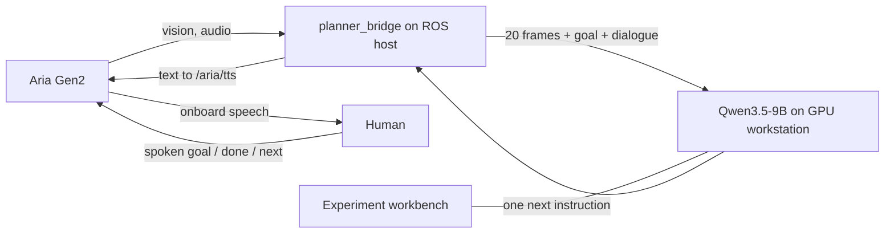

# Aria Visual Guidance

A **Qwen3.5-9B** backend that looks at the last 10 seconds of camera observations and tells a person what to do next. It connects to [sparklabutah/aria2_ros2](https://github.com/sparklabutah/aria2_ros2) through a separate ROS 2 bridge. The service also hosts experiment records and a video-clip workbench.

**Model:** `Qwen/Qwen3.5-9B`. Use the post-trained multimodal checkpoint, not a text-only or Base checkpoint. A predownloaded local model directory is supported; no weights are included in this repository.

## System and interface boundary



The existing Aria node **publishes three topics and subscribes to one**. Those are the only Aria-side dependencies:

| Existing Aria interface | Direction at the Aria node | ROS type | MVP use |
| --- | --- | --- | --- |
| `/aria/rgb/image_raw` | Publishes vision | `sensor_msgs/msg/Image` | RGB frames; sensor-data QoS |
| `/aria/gaze` | Publishes gaze | `geometry_msgs/msg/PointStamped` | Available; not used by the MVP planner |
| `/aria/audio` | Publishes microphone audio | `aria_msgs/msg/Audio` | Interleaved signed int32 samples |
| `/aria/tts` | Subscribes to text | `std_msgs/msg/String` | One utterance per instruction |

The bridge does not require additional services or modifications to the Aria node. `/planner/goal`, `/planner/command`, `/planner/status`, `/planner/transcript` and `/planner/listen` belong to **this new bridge**, not to the existing infrastructure. They provide local controls and diagnostics. Topic names for vision, audio and TTS are configurable.

The protocol is user-paced: set a goal → collect observations → receive one instruction → act → say or send `done` / `next` → observe again. Cancelling or replacing a goal invalidates pending model output.

## 1. Deploy the backend locally

Clone this repository with its pinned infrastructure reference:

```bash
git clone --recurse-submodules https://github.com/10-OASIS-01/aria_vlm.git
cd aria_vlm
# If already cloned without submodules:
git submodule update --init --recursive
```

`external/aria2_ros2` is a Git submodule pinned to
[`1af73bd`](https://github.com/sparklabutah/aria2_ros2/commit/1af73bdd179f5c31ce7dbbfa6d78bfc0727a99a6).
GitHub displays the directory as `aria2_ros2 @ 1af73bd`. It is a reference to upstream
infrastructure; no changes to that upstream code are required. The repository
contains the backend, bridge, experiment workbench and deployment documentation.
Local task-board data, verification tools, recordings and model weights are excluded.

Use Linux, Python 3.10 or newer, a CUDA-enabled PyTorch installation, and an NVIDIA GPU. A 32 GB GPU is recommended for BF16 weights and twenty images. The backend and the Aria ROS environment are separate environments; they may run on the same machine or different machines.

From this repository's root:

```bash
python3 -m venv .venv
source .venv/bin/activate
python -m pip install --upgrade pip
# Install PyTorch/torchvision wheels appropriate for your NVIDIA driver first.
# Example for a CUDA 13.0-capable driver:
python -m pip install torch torchvision --index-url https://download.pytorch.org/whl/cu130
python -m pip install -e '.[model,speech]'
cp .env.example .env
```

Edit `.env` for your machine:

```dotenv
ARIA_MODEL_PATH=./models/Qwen3.5-9B
ARIA_ASR_MODEL_PATH=./models/faster-whisper-small
HF_HOME=./models/hf-cache
CUDA_VISIBLE_DEVICES=0
ARIA_DEVICE=cuda:0
ARIA_HOST=127.0.0.1
ARIA_PORT=8785
ARIA_DATA_DIR=./.runtime
ARIA_ROOT_PATH=
```

`ARIA_MODEL_PATH` can point directly to an existing directory containing `config.json`, tokenizer/processor files and all four safetensors shards. Relative paths resolve from the project root when using `scripts/service.sh`. GPU numbering inside PyTorch is relative to `CUDA_VISIBLE_DEVICES`.

If weights are not already available, download them once:

```bash
export HF_HOME=./models/hf-cache
python scripts/download_model.py --repo Qwen/Qwen3.5-9B --output ./models/Qwen3.5-9B
python scripts/download_model.py --repo Systran/faster-whisper-small --output ./models/faster-whisper-small
```

Use your organization's permitted network route or Hugging Face mirror, if needed. The downloader respects `HF_ENDPOINT`; it does not start a VPN or install global proxy settings. Existing local checkpoints are loaded without contacting the model hub. ASR uses faster-whisper small on CPU in int8; leave `ARIA_ASR_MODEL_PATH` empty if you only need typed goals.

Start in the foreground:

```bash
bash scripts/service.sh run
```

Or keep it running after disconnecting, with `tmux` installed:

```bash
bash scripts/service.sh start
bash scripts/service.sh status
# Stop only this project's tmux session:
bash scripts/service.sh stop
```

Open **http://127.0.0.1:8785/**. `/api/health` checks the process; `/api/ready` returns HTTP 200 only after the model has loaded. Startup runs in the background so the workbench remains available while weights load. Use **one server worker**: every worker would load its own model.

The model uses BF16, SDPA, `enable_thinking=False`, greedy decoding and at most 96 output tokens. The default image budget is 131,072 pixels per frame. `ARIA_MAX_PIXELS` can increase this for small objects at a cost in memory and latency. See [validation notes](docs/validation.md) for the measured environment and limits.

## 2. Reach a backend on another workstation

An SSH tunnel keeps the backend listening on loopback. Run this on the machine that will run the ROS bridge:

```bash
ssh -N -L 8785:127.0.0.1:8785 USER@GPU_HOST
```

The bridge can then use `http://127.0.0.1:8785`. Verify it from that machine:

```bash
curl --noproxy '*' http://127.0.0.1:8785/api/ready
```

For an existing reverse proxy, see [deploy/nginx-location.conf](deploy/nginx-location.conf). It maps `/aria/` to `127.0.0.1:8785/` and strips the prefix. Set `ARIA_ROOT_PATH=/aria` in the backend environment. The frontend uses relative asset and API URLs, including images and downloads. Register the route in both the active proxy configuration and any configuration generator you maintain, then validate and reload Nginx. A service using HTTP on port 443 still needs an `http://` URL.

For authenticated write endpoints, set the same nonempty `ARIA_API_TOKEN` in the backend and bridge environments. The web workbench will offer a token field. The default is intended for a trusted lab network or SSH tunnel.

## 3. Install the bridge next to aria2_ros2

The Aria host should use **Ubuntu 22.04, ROS 2 Humble and its Python 3.10 environment**, as required by the current upstream SDK. The GPU backend can use a newer Python on another machine.

The source interface was inspected at upstream commit `1af73bdd179f5c31ce7dbbfa6d78bfc0727a99a6`. Follow the upstream README for installing ROS, `uv`, device certificates and the glasses' USB/Wi-Fi connection. Confirm that its camera/audio streams and TTS work before testing this bridge.

Starting from this guidance repository:

```bash
export GUIDANCE_REPO="$PWD"
cd "$GUIDANCE_REPO/external/aria2_ros2"
./setup_env.sh
source activate.sh

# Install only the lightweight guidance package into the Aria venv.
# Preserve the upstream numpy, setuptools, pytest and SDK pins.
uv pip install --python "${ARIA_VENV:-$PWD/.venv}/bin/python" -e "$GUIDANCE_REPO"

ln -s "$GUIDANCE_REPO/ros2_ws/src/aria_planner_bridge" src/aria_planner_bridge
python -m colcon build --symlink-install --packages-select aria_planner_bridge
source activate.sh
```

If you already have a working `aria2_ros2` checkout, use it instead of the submodule and do not rerun its setup. When using a source ZIP without Git metadata, clone upstream separately and check out commit `1af73bdd179f5c31ce7dbbfa6d78bfc0727a99a6`. Build the bridge after sourcing that checkout's `activate.sh`. Install the backend's model dependencies only in the GPU environment. The bridge imports no torch or transformers modules.

`activate.sh` currently sets `ROS_DOMAIN_ID=42`; all Aria and bridge terminals must join the same domain. Start the Aria node using your lab's known working launch configuration. In another terminal:

```bash
cd "$GUIDANCE_REPO/external/aria2_ros2"
source activate.sh
ros2 launch aria_planner_bridge bridge.launch.py backend_url:=http://127.0.0.1:8785
```

For a backend behind a prefix, pass the complete base URL, for example `backend_url:=http://GPU_HOST:443/aria`. A custom YAML file can be supplied with `config:=...`; see [bridge.yaml](ros2_ws/src/aria_planner_bridge/config/bridge.yaml). Use `ros2 topic list -t` to confirm the actual camera/audio/TTS names and change those three parameters if your lab's configuration differs.

## 4. Run a task through the glasses

In a sourced ROS terminal, inspect the bridge:

```bash
ros2 topic echo /planner/status
```

In a second terminal, give a goal:

```bash
ros2 topic pub --once /planner/goal std_msgs/msg/String "{data: 'Put each colored cube into the tray of the same color.'}"
```

Keep the work area visible. Once a complete camera window is available, the bridge sends twenty distinct frames and publishes the returned instruction to `/aria/tts`. Perform the action and request the next step:

```bash
ros2 topic pub --once /planner/command std_msgs/msg/String "{data: 'done'}"
# Other controls:
ros2 topic pub --once /planner/command std_msgs/msg/String "{data: 'repeat'}"
ros2 topic pub --once /planner/command std_msgs/msg/String "{data: 'cancel'}"
```

To supply a goal or feedback by microphone, use the bridge's push-to-talk service:

```bash
ros2 service call /planner/listen std_srvs/srv/SetBool "{data: true}"
# Speak a goal, 'done', 'next', 'repeat', 'cancel', or a correction.
ros2 service call /planner/listen std_srvs/srv/SetBool "{data: false}"
ros2 topic echo /planner/transcript
```

The bridge buffers the existing `/aria/audio` blocks, downmixes channels, converts signed int32 PCM to WAV, and calls local ASR. With no active task, recognized speech becomes the goal. During a task, `done`/`next` requests a new step; other speech becomes feedback. Say `goal: ...` or publish a new `/planner/goal` to replace a task explicitly. Recording is limited to 20 seconds. It is push-to-talk by design. Recording cannot begin while planning or estimated playback is active, and planning pauses while recording or transcription is active.

Upstream does not report playback completion or offer a TTS cancel acknowledgement. The bridge sends one instruction per user request, deduplicates request IDs, and uses an estimated speaking interval to guard repeats and recording. Cancelling suppresses **unsent** planner output; it cannot retract speech already handed to the glasses.

## Troubleshooting

| Symptom | Check |
| --- | --- |
| `/api/health` works but `/api/ready` is 503 | Read `.runtime/logs/service.log`; model load may still be running. Check CUDA, the model directory and dependency versions. There is no mock fallback. |
| `ModuleNotFoundError: Qwen3_5...` | Use this project's pinned `transformers==5.3.0` in the backend environment. |
| CUDA out of memory | Select a GPU with more free memory, use one server process, and keep the default frame pixel budget. Stop only processes you own. |
| Bridge stays on `collecting` | Verify topic names, sensor-data QoS, a continuous camera stream and about ten seconds of observations. Dropped frames are not padded by duplicating images. |
| Live timestamps rejected | Synchronize the ROS host and GPU workstation clocks. Use Aria's host-time capture stamps; replay requests use relative timestamps. |
| No speech recognized | Check the ASR model path, microphone sample rate, channel count and signal level; adjust `audio_gain` if your SDK's int32 scale differs. |
| No instruction heard | Verify a manual `/aria/tts` message first; inspect `/planner/status` for stale results, speech guard or inference errors. |
| HTTP 409 | A previous instruction needs feedback, an ID is being reused with changed input, or the task was cancelled. |
| HTTP 429 | Another inference/ASR call is active. Wait and request a fresh observation. |
| Assets fail behind `/aria/` | Ensure the proxy strips `/aria/`, preserves the trailing-slash redirect, and the backend has `ARIA_ROOT_PATH=/aria`. |

All source paths and example configuration are portable. Keep machine-specific paths, tokens, tunnels and deployment records in `.env` or another excluded local configuration. `scripts/build_release.py` packages source and documentation using an explicit allowlist; it excludes model weights, recorded sessions and local machine configuration.
