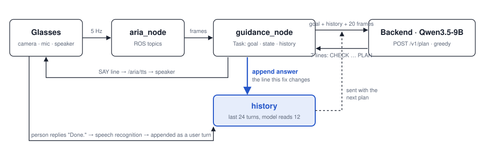
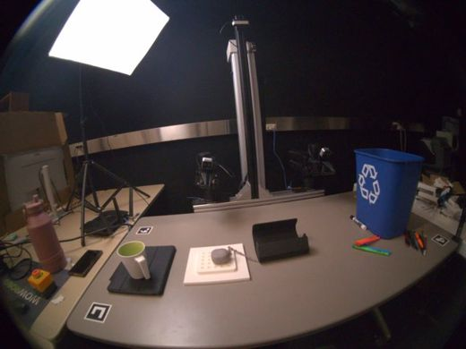
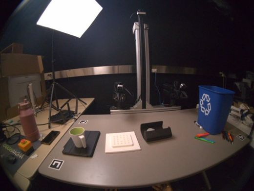
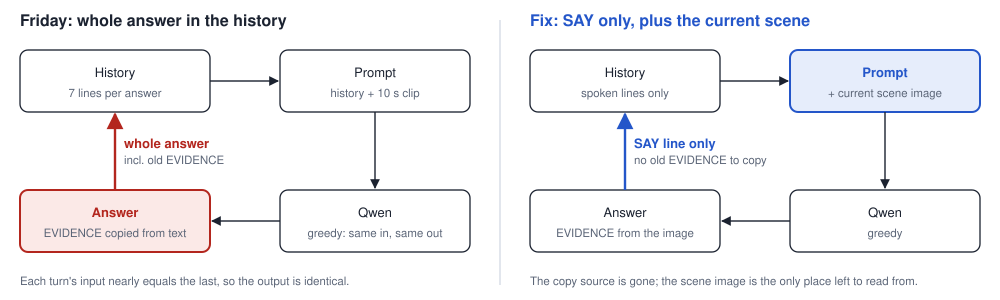
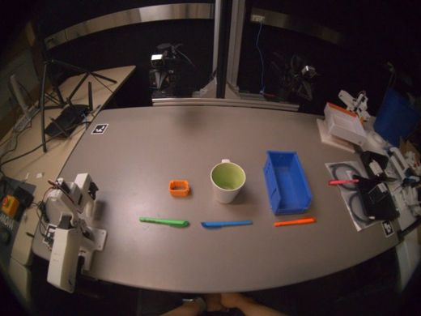

# Why the guide repeated itself

In trial `20261030T211037Z_cdcaa6a4/trials/03_151717` (Friday, 2026-10-30) the guide told the person to move the earbuds three times in a row, word for word, after the earbuds were already on the tray. This page covers how one guidance step works, what the model saw, why it locked into a loop, and the code that changes it. The fix is in the working tree, dated 2026-10-31, not yet committed.

**In short**

1. Each plan sends the model the dialogue history. On Friday that history held the model's whole earlier answers, including its old `EVIDENCE` line.
2. The model rebuilt its new `EVIDENCE` from that old text instead of from the camera, so it said the earbuds were "still on white platform". Greedy decoding then produced the identical answer every turn.
3. The fix keeps only the spoken `SAY` line in the history and gives the model one sharp image of the current scene. An offline replay of the same frames no longer repeats.

## 1. How one guidance step works



`guidance_node` sends the goal, the history and the last 10 s of camera to Qwen. It speaks the `SAY` line and appends a turn to the history. The history goes out again with the next plan, so whatever is appended there is what the model reads about its own past. The person's reply ("Done.") goes through speech recognition and is appended as a user turn.

Qwen answers in seven fixed lines. Only `SAY` is spoken; the rest is logged as the `proposal`.

| Line | Meaning |
| --- | --- |
| `CHECK` | Is the `EXPECT` of my last answer true now? yes, no, unknown, none |
| `EVIDENCE` | What I see now that decides this step |
| `UNKNOWN` | A fact the scene does not show, or none |
| `MODE` | ACT, INSPECT, ASK, REPLAN, DONE |
| `SAY` | The sentence spoken to the person |
| `EXPECT` | What should be visible after this step |
| `PLAN` | Steps left after this one |

## 2. The previous step: what happened on Friday

| 14.2 s, after step 1 | 42.0 s, after step 2 |
| --- | --- |
|  |  |
| Mug on the iPad case (left), earbuds on the white platform. The model read this correctly. | Platform empty, earbuds in the black tray. The task is finished, but the model said the earbuds were still on the platform. |

| Time | Person | Camera showed | Model's `EVIDENCE` | Model's `SAY` |
| --- | --- | --- | --- | --- |
| 2.8 s | (goal) | Both items on the platform | Mug and earbuds on white platform | Move the mug to the iPad case |
| 16.8 s | "Done." | Mug on iPad case | Mug moved to iPad case; earbuds still on white platform | Move the earbuds to the black tray |
| 44.8 s | "Done." | **Task finished** | Mug on black tray; earbuds still on white platform | **Same as above** |
| 73.4 s | "Aria, done." | **Task finished** | Mug on black tray; earbuds still on white platform | **Same as above** |

### What the model read at 42.0 s

The dialogue part of the prompt, as Friday's code built it (`engine.py` joins turns as `role: text`):

```text
Goal: I need to clear this white platform, so I need to move the mug and the earbuds either on the iPad or on the BlackTray. ...
Recent dialogue:
assistant: CHECK: none
EVIDENCE: Mug and earbuds on white platform; iPad and BlackTray visible on table.
UNKNOWN: none
MODE: ACT
SAY: Pick up the white mug from the white platform with your right hand and place it on the black iPad case to your left.
EXPECT: Mug on iPad case; earbuds still on platform.
PLAN: Move earbuds to BlackTray; none
user: Done.
assistant: CHECK: no
EVIDENCE: Mug moved to iPad case; earbuds still on white platform.      <-- copied
UNKNOWN: none
MODE: ACT
SAY: Pick up the grey earbuds ... place them on the black tray ...     <-- copied, "black tray" reused
EXPECT: Earbuds on BlackTray; platform clear.                            <-- copied
PLAN: none                                                               <-- copied
user: Done.
[10 s video clip: earbuds now in the black tray, platform empty]
```

The model's output at 44.8 s:

```text
CHECK: no
EVIDENCE: Mug on black tray; earbuds still on white platform.
UNKNOWN: none
MODE: ACT
SAY: Pick up the grey earbuds from the white platform with your right hand and place them on the black tray to your right.
EXPECT: Earbuds on BlackTray; platform clear.
PLAN: none
```

The new `EVIDENCE` line is stitched from the old answer. "Earbuds still on white platform" is the old `EVIDENCE`, and "black tray" comes from the old `SAY`. Neither matches the frame: the mug is plainly on the iPad case. Once `EVIDENCE` says the earbuds have not moved, the rest of the answer follows, and the model gives the same step again.

## 3. Why it locked into a loop, and what the fix cuts



The loop has one feedback edge: what goes back into the history. On Friday that edge carried the old `EVIDENCE`, which the model reused instead of looking. Decoding is greedy (`do_sample=False`), so once one copied answer is in the history, the next input nearly equals the last and the output is identical. The fix narrows the edge to the spoken sentence and adds a clear image of the scene as it is now.

## 4. Fix A: the history keeps only the spoken line

This is the change that stops the copying.

`src/aria_guidance/task.py`, `Task.finish_plan`. After each plan, guidance_node saves the model's answer into the history. Friday saved the whole seven-line answer (`raw_output`); now it saves only `instruction`, the `SAY` sentence the person heard.

```diff
         done = result["status"] == "done_proposed"
         self.state = "awaiting_confirmation" if done else "awaiting_feedback"
-        # The whole answer, so the next plan can check its EXPECT and keep its PLAN.
-        self.add("assistant", (result.get("raw_output") or result["instruction"])[:MAX_TURN_CHARS])
+        # Only what was spoken: given its whole answer, the model copied its old EVIDENCE line
+        # into the next plan and repeated a step that was already done.
+        self.add("assistant", result["instruction"])
         self.last = result
         return True
```

`src/aria_guidance/task.py`, constants. `MAX_TURN_CHARS` only existed to trim the long seven-line answers. A `SAY` line is at most 600 characters (enforced in `parse_output`), so the cap goes.

```diff
 REJECTION = "No, the goal is not complete yet. "
 MAX_HISTORY = 24
-MAX_TURN_CHARS = 1500  # schemas.Turn rejects anything longer.
```

`src/aria_guidance/store.py`, `Store.finish`. The same rule for console workbench sessions, which keep their own copy of the history in SQLite.

```diff
                     else "awaiting_feedback"
                 )
-                text = response.get("raw_output") or response["instruction"]
-                session["history"].append({"role": "assistant", "text": text})
+                session["history"].append({"role": "assistant", "text": response["instruction"]})
                 session["history"] = session["history"][-24:]
```

`tests/unit/test_task.py`. The test pins the new behavior.

```diff
-def test_history_keeps_the_whole_answer_for_the_next_plan():
+def test_history_keeps_only_the_spoken_line():
     task = Task()
     task.start("Tidy up.")
     epoch = task.begin_plan()[0]
     raw = "MODE: ACT\nSAY: Go.\nEXPECT: Gone."
     task.finish_plan(epoch, {"status": "instruction", "instruction": "Go.", "raw_output": raw})
-    assert task.history[-1] == {"role": "assistant", "text": raw}
+    assert task.history[-1] == {"role": "assistant", "text": "Go."}
     assert task.last["instruction"] == "Go."
```

## 5. Fix B: a sharp image of the current scene

Added in the same session after a second failure ("is the orange pen below the green mug?" answered with "right of the green mug"). It helps the model read the scene; fix A is what stops the copying.

What the model receives now, in order:

| Part | Content |
| --- | --- |
| system | The rules: seven output lines, reply handling, locations with top and bottom |
| Goal + Recent dialogue | Last 12 turns; assistant turns are `SAY` lines only (fix A) |
| video | 20 frames, 10 s at 2 Hz, paired into 10 temporal patches |
| **"Current scene, right after the person's last words:" + image** | **New.** The newest frame again, on its own, at full detail |
| Goal + instruction | "Use the current scene image to check whether your last step was done" |

`src/aria_guidance/engine.py`, `QwenEngine._generate`. In the clip the last frame shares a temporal patch with the one before it, so it goes in again as a plain image.

```diff
+        # The newest frame again on its own: in the clip it shares a temporal patch with the
+        # frame before it, and the model repeated steps the person had already done.
+        content.append({"type": "text", "text": "Current scene, right after the person's last words:"})
+        content.append({"type": "image"})
         # Restate the goal after the visual block so it is not lost behind its many tokens.
         content.append(
             {
                 "type": "text",
-                "text": f"Goal: {goal}\nGiven the current scene (the newest moment), reply in the "
-                "OUTPUT format.",
+                "text": f"Goal: {goal}\nUse the current scene image to check whether your last "
+                "step was done, then reply in the OUTPUT format.",
             }
         )
```

The processor gets the matching pixels. The number of image slots in the prompt and the number of images passed in must stay equal, or every plan fails.

```diff
-            visual = {"videos": [images], "video_metadata": [metadata], "do_sample_frames": False}
+            visual = {
+                "videos": [images],
+                "video_metadata": [metadata],
+                "do_sample_frames": False,
+                "images": [images[-1]],
+            }
         else:
-            visual = {"images": images}
+            visual = {"images": images + [images[-1]]}
```

`SYSTEM_PROMPT`. The prompt names the image, adds top and bottom, and answers "where is it" questions first.

```diff
-INPUT: The goal, the dialogue so far with all the lines of your earlier answers, and the last
-10 seconds of camera view, oldest first. The newest moment is the current scene; earlier
-moments show progress.
+INPUT: The goal, the dialogue so far with all the lines of your earlier answers, the last
+10 seconds of camera view, oldest first, and then one still image of the current scene, taken
+after the person last spoke. Decide CHECK and EVIDENCE from that image; earlier moments show
+progress.
 ...
-CHECK: Is the EXPECT of your last answer true in the newest moment? ...
+CHECK: Is the EXPECT of your last answer true in the current scene image? ...
 ...
-- Name the object by colour or shape and say where it is from the person's view (left, right,
-  ahead, next to a landmark). For a placement, name the destination the same way.
+- Name the object by colour or shape and say where it is in the person's view: left or right,
+  top (farther away) or bottom (nearer to them), and next to which landmark, e.g. "bottom
+  right, below the blue tray". For a placement, name the destination the same way.
 ...
+- A question about where something is: answer it first from the newest moment. Name the object
+  and where it is in the person's view (left, right, top, bottom) and next to which landmark. "Below"
+  or "under" means bottom of, nearer to them; "above" or "behind" means top of, farther away. If you
+  cannot see it, say so and use INSPECT. Then give the step.
```

## 6. Checking the fix: an offline replay

Qwen loaded in a standalone script and replayed the trial's exact 20 frames with the current engine code, changing only the history. Output is deterministic, so each case ran once.

| Case | History given | Result |
| --- | --- | --- |
| F2 | Whole answers, as on Friday | Repeat: same answer as the trial, character for character |
| F4 | Whole answers, after one repeat | Repeat: identical again, the third repeat |
| F1 | `SAY` lines only (the fix) | No repeat; asks "Where are the earbuds?" instead |
| F5 | `SAY` lines only, repeated line included | No repeat; same question as F1 |
| F3 | No assistant turns at all | No repeat; misreads the scene a different way |

Putting the whole answer back reproduces the bug exactly; taking it out stops it. That isolates the copy as the cause of Friday's repeat.

## 7. What the fix does not solve



Saturday, trial `20261031T174927Z_e77c71e4/trials/01_115023`. The person said "I want it to be in the same color." The model repeated "place it into the small orange container" word for word.

- **Different cause.** This repeat is not a copy. With its earlier line removed from the history, the model still sends the green pen to the orange box. It does not see the green-lined mug as the green container, so "same color" changes nothing for it; only the wording is copied. A specific reply, "Green pen goes in the green container", fixes it.

  | Case | History given | `SAY` |
  | --- | --- | --- |
  | S1 | As in the trial | Identical: green pen to the orange container |
  | S2 | Assistant turn removed | Different words, same step |
  | S3 | Old `SAY` paraphrased | Different words, same step |
  | S4 | "Green pen goes in the green container" | Corrected: green pen to the green container |

- **Fix B on the Friday moment.** With the current code the Friday moment stops repeating but asks where the earbuds are instead of proposing DONE. Across the held-out trials in section 8 the current code misses 1 of 7 finished tasks.
- **Prompt wording.** The prompt now describes the history it gets: earlier `SAY` lines, and a CHECK on the step of the last `SAY`. Its PLAN line still says to keep the steps of the last PLAN, which is not in the history.
- **Correction guard.** When the person corrects a step and the answer gives the same step again, the engine plans once more with the correction spelled out (section 8). An identical `SAY` after "done" is still caught only by the prompt.

## 8. Held-out test and the correction guard

Every decision point of 10 recorded trials was labelled from its frames: whether the previous step was done, whether the person rejected it, and whether the goal was met (`scripts/trial_labels.json`). Four trials (19 points) are the dev split used to debug; six trials (33 points) are held out and were scored once. `python scripts/replay_eval.py --trials scripts/trial_labels.json --split heldout` reruns it.

| Held out | Friday code | Fix A and B | Plus guard and wording |
| --- | --- | --- | --- |
| Same step again after it was done or rejected | 3/23 | 2/23 | 0/23 |
| DONE before the goal was met | 0/26 | 0/26 | 0/26 |
| No DONE when the goal was met | 3/7 | 1/7 | 1/7 |
| Seconds per plan | 2.3 | 2.4 | 2.6 |

- **Guard.** After a plan, the engine asks the model whether the new `SAY` is the same step as the last one. If it is, and the intent classifier labels the person's reply a correction, the engine plans again with "the person rejected your last instruction and said ...; do not give that step again". A second repeat becomes the question "That step does not seem to work. What should be different?". The dropped step is kept in `proposal.replaced`. On the Saturday pens the answer becomes "Where should the green pen go? Is there a green container nearby?".
- **Belief loop, not kept.** A loop that listed goal facts, checked each one as true or false on the current image and planned from that checklist repeated least (1/23), but missed DONE on all 7 finished tasks and took 5.9 s per plan. The single-image true or false check answers "false" too often. Asked an open question ("what is on the white platform?") the same model was right on 4 of 4 frames, so a checker built on open questions is the next thing to try.
- **Limits.** 33 points from 6 trials, all pick-and-place in one lab. A difference of one or two points is within noise. The judge for "same step" is the same model call the guard uses.
